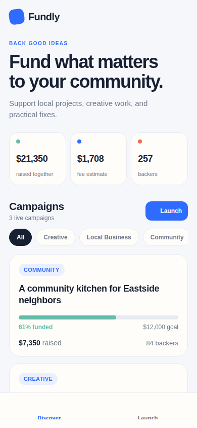
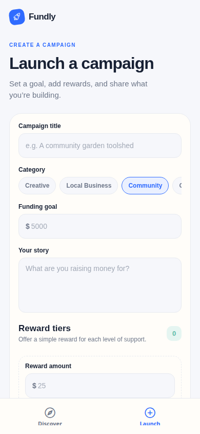
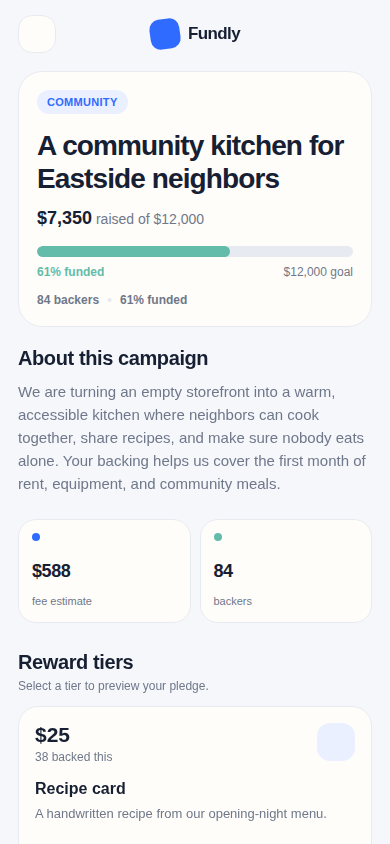

# Fundly

Fundly is a small, portrait-first crowdfunding app for backing local projects, creative work, and community ideas.

The app is intentionally honest about its scope: campaigns and pledges are persisted locally for the demo, and pledges are simulated. No payment is taken.



## What it does

- Browse seeded and user-created campaigns by category.
- See funding progress, raised totals, backers, and an 8% platform-fee estimate.
- Open a campaign to read its story and choose a reward tier.
- Record a simulated pledge with no real payment processing.
- Launch a campaign with a title, category, goal, story, and one or more reward tiers.
- Persist campaign and pledge data locally across sessions.

## Screenshots

| Discover | Launch | Campaign detail |
| --- | --- | --- |
|  |  |  |

## Tech stack

- Expo 57 and Expo Router
- React Native with React Native Web
- TypeScript
- NativeWind-compatible starter setup
- AsyncStorage for local demo persistence
- Vitest, ESLint, and TypeScript checks

## Getting started

### Requirements

- Node.js 20 or newer
- pnpm 9
- Expo-compatible development environment, or a browser for the web preview

### Install and run

```bash
pnpm install
pnpm dev
```

The development scripts start the Expo web preview on port `8081` and the starter API on port `3000`.

For native development:

```bash
pnpm android
pnpm ios
```

### Verify the project

```bash
pnpm check
pnpm lint
pnpm test
```

## Project structure

```text
app/
  (tabs)/index.tsx       # Discover campaigns
  (tabs)/launch.tsx      # Create a campaign
  campaign/[id].tsx      # Campaign detail and simulated pledge
components/fundly/       # Fundly UI primitives
lib/campaign-store.ts    # Typed local persistence and mutations
shared/types.ts          # Campaign and reward-tier models
assets/images/           # Launcher, splash, and favicon identity
```

## Product notes

Fundly is a focused prototype rather than a production fundraising platform. It does not include accounts, moderation, campaign image uploads, a hosted database, payments, refunds, tax receipts, or fraud controls. Those are deliberate next steps for a production version, not hidden behavior.

The 8% value is displayed as an estimate to mirror the original prototype. Pledges update local campaign totals only and never move money.

## Contributing

Issues and pull requests are welcome. Please keep changes focused, preserve the portrait-mobile experience, and run `pnpm check`, `pnpm lint`, and `pnpm test` before opening a pull request. See [CONTRIBUTING.md](CONTRIBUTING.md) for the short contribution guide.

## License

Fundly is released under the [MIT License](LICENSE).
